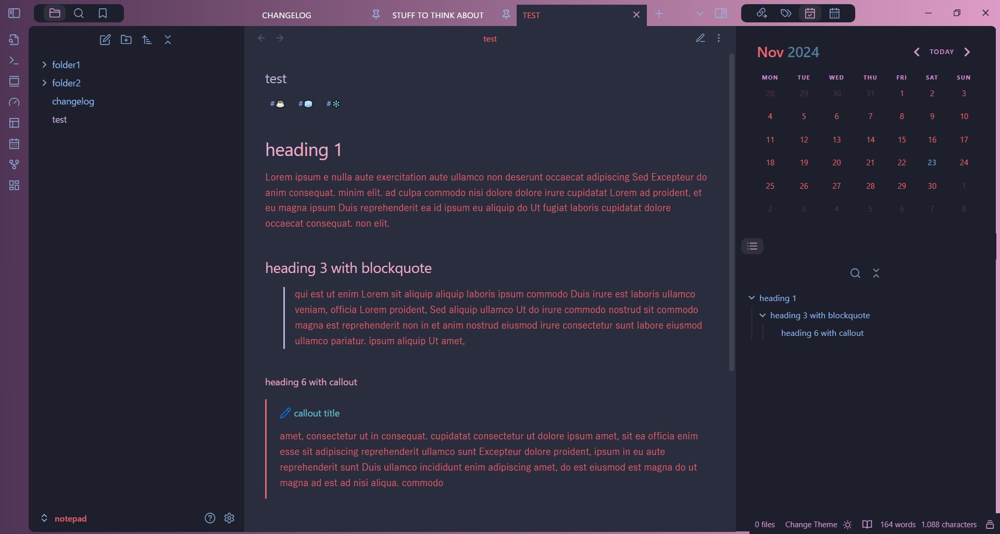
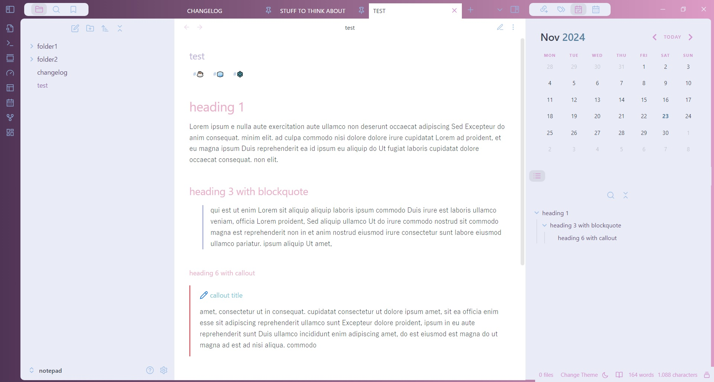

# Mulled Wine

A gradient theme with ethereal colors in dark and light mode.

The gradient frame coding has been done by Kapirklaa.

dark mode:

light mode:

## Installation

1. Open Obsidian and go to **Settings > Appearance**.
2. Next to **Themes**, select **Manage**.
3. Search for "Mulled Wine", then select **Install and use**.

To install by hand, download `manifest.json` and `theme.css` from the [latest release](https://github.com/incantatem2/Obsidian-mulled-wine/releases/latest). Put both files in a folder named `Mulled Wine` inside `.obsidian/themes/` in your vault. Then choose the theme under **Settings > Appearance > Themes**.
